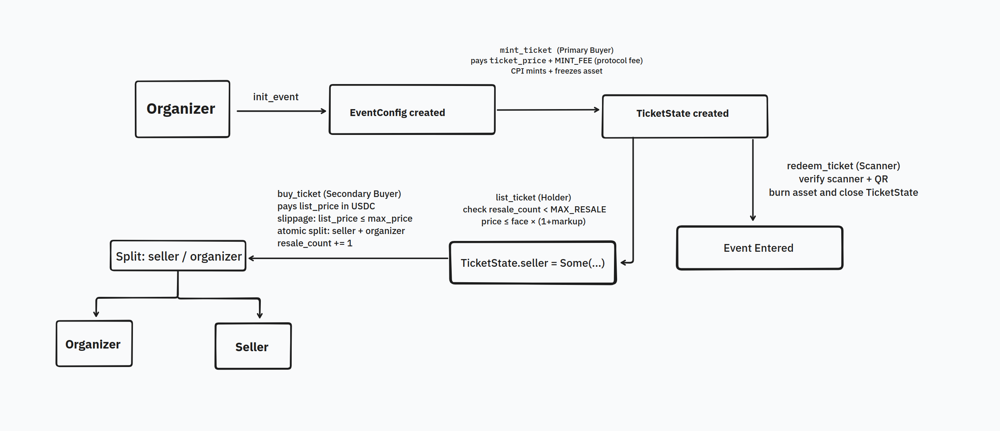
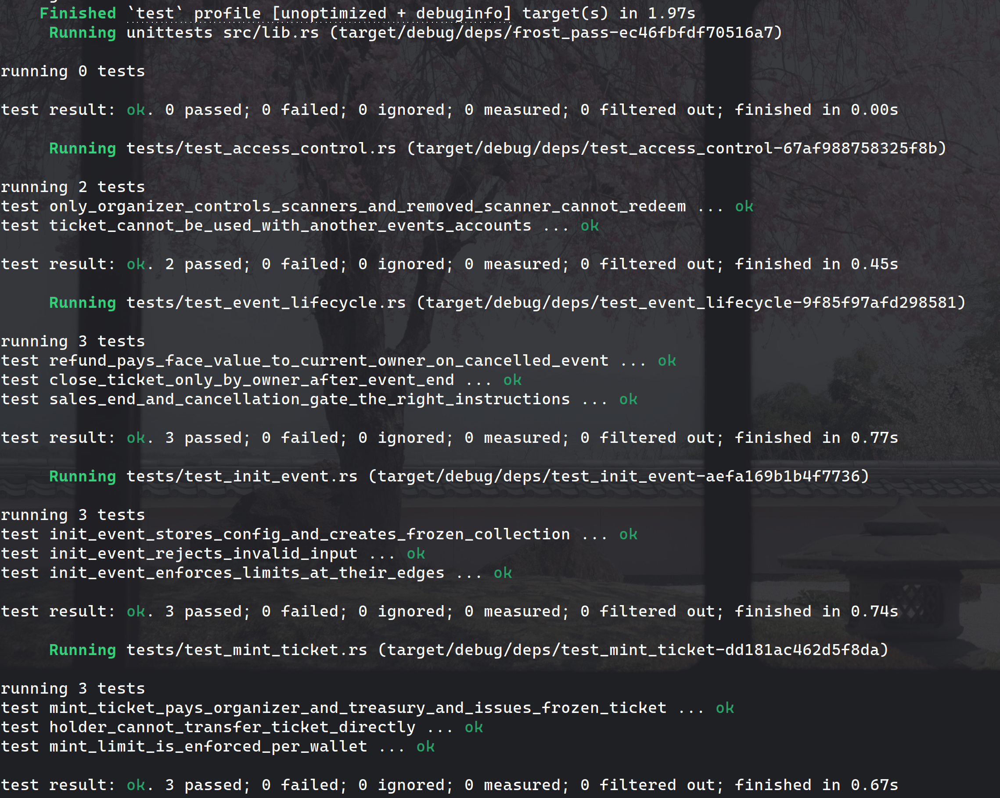
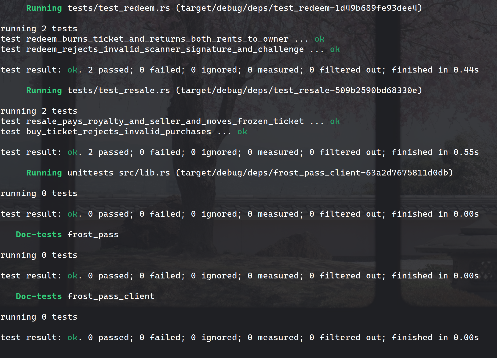

# FrostPass

FrostPass is an event-ticketing program on Solana that stops scalping and off-platform resale. Every ticket is a [Metaplex Core](https://developers.metaplex.com/core) asset that stays **frozen** in its holder's wallet for its whole life, so it can't be sent, sold or burned outside the program. Resales go through FrostPass, which enforces the organizer's price cap, a resale limit and the organizer's royalty, and pays everyone in USDC in the same transaction. At the door, the holder signs a short-lived QR challenge and a scanner redeems the ticket, which burns it.

- **No scalping:** resale prices are capped at face value plus the organizer's markup (0–20%), and each ticket can be resold at most twice.
- **No side-channel transfers:** tickets are frozen by the event collection; only the program can move or burn them.
- **No screenshot fraud:** entry needs a fresh signature from the ticket's current owner, valid for at most 90 seconds.
- **Organizers keep earning:** a royalty (up to 5%) on every resale, paid automatically.

Built with Anchor 1.2 (Rust), Metaplex Core and USDC on the SPL Token program. FrostPass currently runs on **devnet only**.

## Devnet deployment

|                         |                                                                                                                            |
| ----------------------- | -------------------------------------------------------------------------------------------------------------------------- |
| **Program ID**          | `8GqPBbxtkA9PbQYmAfb4SrU56tHiYaBh5kPUsHtM2hjk`                                                                             |
| **ProgramData address** | `ACrmNEjgMKXMQTcGmMB9eVTohkWBzC2aunconbrtpESL`                                                                             |
| **Explorer**            | [View on Solana Explorer](https://explorer.solana.com/address/8GqPBbxtkA9PbQYmAfb4SrU56tHiYaBh5kPUsHtM2hjk?cluster=devnet) |
| **Payment mint**        | Devnet USDC `4zMMC9srt5Ri5X14GAgXhaHii3GnPAEERYPJgZJDncDU`                                                                 |
| **Protocol treasury**   | Squads multisig vault `9TRRTfqqfeMiACKETs6NUgdAamyxYLggNMbB2S1Jte97`                                                       |

The deployed binary is byte-identical to the SBPF v0 build the test suite runs against.

## Architecture



### Tickets are frozen Core assets

When an organizer creates an event, `init_event` creates a Metaplex Core **collection** for it with three permanent plugins, all controlled by the event's `EventConfig` PDA:

| Plugin                             | What it does                                                                                      |
| ---------------------------------- | ------------------------------------------------------------------------------------------------- |
| `PermanentFreezeDelegate` (frozen) | No ticket in the collection can be transferred or burned by its holder                            |
| `PermanentTransferDelegate`        | The program can move a sold ticket to its buyer without the seller signing                        |
| `PermanentBurnDelegate`            | The program can burn a ticket at redeem, on a refund, or when its owner closes it after the event |

Collection plugins apply to every asset in the collection, so every ticket is frozen from the moment it's minted, including after it changes hands. A delegate the holder adds themselves is still blocked by the freeze. Because the PDA can move or burn any ticket of the event, every instruction that does so checks the ticket, its owner and its listing first.

### Accounts

| Account        | Seeds                                     | Holds                                                                                                                   |
| -------------- | ----------------------------------------- | ----------------------------------------------------------------------------------------------------------------------- |
| `EventConfig`  | `["event", organizer, event_id (u32 LE)]` | Organizer, collection, ticket price and supply, markup cap, royalty, `sales_end`, `event_end`, scanners, cancelled flag |
| `TicketState`  | `["ticket", ticket_asset]`                | Event, resale count, listing (`seller`, `list_price`)                                                                   |
| `MinterRecord` | `["minter", event_config, minter]`        | Primary mints by this wallet for this event (max 3)                                                                     |

The ticket's owner is read from the Core asset itself; there are no ticket mints or token accounts.

### Instructions

| Instruction       | Signer    | What it does                                                                              |
| ----------------- | --------- | ----------------------------------------------------------------------------------------- |
| `init_event`      | Organizer | Creates `EventConfig` and the frozen event collection                                     |
| `update_scanners` | Organizer | Replaces the list of door scanners (max 5)                                                |
| `cancel_event`    | Organizer | Cancels the event; blocks mint, list, buy and redeem                                      |
| `mint_ticket`     | Buyer     | Primary sale: mints a frozen ticket in the collection                                     |
| `list_ticket`     | Holder    | Lists a ticket at a price up to face value × (1 + markup cap). Nothing moves              |
| `delist_ticket`   | Holder    | Cancels a listing, at any time                                                            |
| `buy_ticket`      | Buyer     | Resale: pays the seller and organizer, moves the ticket to the buyer (still frozen)       |
| `redeem_ticket`   | Scanner   | Verifies the owner's signed QR challenge, burns the ticket, returns its rent to the owner |
| `refund_ticket`   | Organizer | On a cancelled event, pays the holder face value and burns the ticket                     |
| `close_ticket`    | Holder    | After the event, burns an unused ticket to reclaim its rent                               |

`sales_end` closes minting and resales; `event_end` is when tickets stop being redeemable, so entry keeps working after sales close.

### Payments

All payments are in USDC and go **directly between wallets** in the same transaction; the program never holds funds.

- **Primary sale:** the buyer pays `ticket_price` to the organizer plus a fixed `MINT_FEE` of 0.25 USDC to the protocol treasury.
- **Resale:** the buyer pays `list_price`, capped by the buyer's `max_price` (slippage protection). The organizer's royalty (`royalty_bps`, at most 5%) goes to the organizer and the rest to the seller. There is no protocol fee on resales.

Fee math uses checked `u128` arithmetic, and the seller or organizer takes the remainder, so no rounding dust is lost.

### Entry: the QR challenge

A scanner can't burn tickets on its own. At the door, the holder's wallet signs a 136-byte challenge, shown as a QR code:

| Field                | Bytes |
| -------------------- | ----- |
| `"FROSTPASS_TKT_V1"` | 16    |
| `event_config`       | 32    |
| `ticket_asset`       | 32    |
| owner                | 32    |
| nonce                | 16    |
| expiry (i64 LE)      | 8     |

The scanner submits the transaction with an Ed25519 signature-verification instruction immediately before `redeem_ticket`. The program checks that the signature is from the ticket's current owner, over exactly this message, and that the challenge expires within 90 seconds. Because the message includes the owner, an old QR code is useless once the ticket is sold.

## Tests

15 integration tests run in [LiteSVM](https://github.com/LiteSVM/litesvm) against the real SBF build of the program and the Metaplex Core program binary, with a fake 6-decimal USDC mint at the devnet USDC address.

| File                      | Covers                                                                                                    |
| ------------------------- | --------------------------------------------------------------------------------------------------------- |
| `test_init_event.rs`      | Stored config and frozen collection; every limit at its edge; invalid input                               |
| `test_mint_ticket.rs`     | Payments to organizer and treasury; the freeze blocks direct transfers; 3-per-wallet mint limit           |
| `test_resale.rs`          | Royalty and seller payouts, ticket stays frozen after resale; buy rejections                              |
| `test_redeem.rs`          | Burn and rent refund to the owner; wrong scanner, wrong signer, wrong or expired challenge                |
| `test_access_control.rs`  | A ticket can't be used with another event's accounts; only the organizer controls scanners                |
| `test_event_lifecycle.rs` | Refunds only on cancelled events; `close_ticket` timing and ownership; `sales_end` and cancellation gates |

All 15 pass:





### Devnet run

The complete instruction suite runs against the deployed program on devnet:

| Step | Instruction | Description | Transaction |
| ---- | ----------- | ----------- | ----------- |
| 1 | `init_event` | Organizer creates event & frozen collection | [`5WttUzYn…`](https://explorer.solana.com/tx/5WttUzYnR5tAvPFFdKpj5wBVGon3y6Ye9S35BhSB2DAfB5N3yarJ8RNds18Un9S2Rw2CkAo8tRYtNC4BDmSEt7Hd?cluster=devnet) |
| 2 | `update_scanners` | Organizer whitelists door gatekeeper scanners | [`37Mdm4aF…`](https://explorer.solana.com/tx/37Mdm4aFF5ZqPagHqvJbUSVFMfys4xQ2VrCdHMRCcHL4cj7wyiRcpMhZDxp9Pw1zmADPbPdM3mrHE9kgTnTDfBeJ?cluster=devnet) |
| 3 | `mint_ticket` | Buyer 1 mints ticket (asset [`ARuB9qFp…`](https://explorer.solana.com/address/ARuB9qFpDRRb6BfaTNcXixd1t81HEEVM1JsiMjaXQhdg?cluster=devnet)) | [`5uEeLdPu…`](https://explorer.solana.com/tx/5uEeLdPuyqRA6afRjejxD66vywtihwzfApRMWztvdJnYc2E2FJD3ePBSXztwGCR9EstxFuEcHRxxhvkjwC75vmkP?cluster=devnet) |
| 4 | `list_ticket` | Buyer 1 lists ticket within markup cap | [`4zfwmMG8…`](https://explorer.solana.com/tx/4zfwmMG8896bNyB3gQtygQNmePwk65Qg1uqMuZnFL3xgQMefLUbmiBGvWdTvnAt3Ahyuf9ymgir1Kbvvgjwv6fDY?cluster=devnet) |
| 5 | `delist_ticket` | Buyer 1 delists ticket | [`5e7PdwTW…`](https://explorer.solana.com/tx/5e7PdwTWSZP4DRfFTYwonrYr3NzH2vr6zvycc26gK8ibhWddkcXV3wKwzzi6SecEq99skWynrzfR2nPeZbDaFTTu?cluster=devnet) |
| 6 | `buy_ticket` | Buyer 2 purchases ticket on secondary market | [`3Qgh6iRL…`](https://explorer.solana.com/tx/3Qgh6iRL5wP1LSz7gknCKSrGsV4Pw7fCt1u3sUuVHZ7f7z7Rjmi4rPhfRC8UC6gKEFvj75s5K7dwLVzKBsc8qUks?cluster=devnet) |
| 7 | `redeem_ticket` | Gatekeeper verifies Ed25519 QR challenge & burns ticket | [`HZXt7X2H…`](https://explorer.solana.com/tx/HZXt7X2H8kfEM5mNEyFUN8rdAA5eoChSmJboLTLJcvdGJauKr7zptTBbxEJfmHzEs9Vh2DnXbjfP1caPipfueMi?cluster=devnet) |
| 8 | `cancel_event` | Organizer cancels event | [`4serzrUz…`](https://explorer.solana.com/tx/4serzrUzQp48TgVcxLVTG1zMLzhShqvirUFm2TqNUpehFFEJA73AAbTBa1rQLaeJxmELC49p2HNtMSknqFypMcVn?cluster=devnet) |
| 9 | `refund_ticket` | Organizer refunds face value to holder & burns ticket | [`skhkJZB6…`](https://explorer.solana.com/tx/skhkJZB6fKG5eRfVvohpcU4w3tfHnfP3QypRYY91SA9quoPg7NsnKDAB96cr8YZKYqk8QWdUkrQsCxvHiFFHJ6e?cluster=devnet) |
| 10 | `close_ticket` | On-chain lifecycle constraint validation (`current_time >= event_end`) | Verified on-chain |

Organizer: `FZFZLbrBExacfhFE6K9uUKjvxT1HEuvtsqXTP9pMkvRb`, Buyer 1: `6EYMFrYYA1AW6U7nY6TXYNCtCB21fmmoyZpWaoZGCzMw`, Buyer 2: `6p1EVapx48y7B6sZ9ti6ZZNtUgeEYxi3wWn6g9CCnmad`, Gatekeeper: `64EsMgDFyJqMquk8dQuqdJUcKqp7DQa3jRWBMyxtznE8`.

## Build and test

Requires Rust, the Solana CLI and Anchor CLI 1.2.0 (pinned in `frost-pass/Anchor.toml`; with `avm`, `anchor` switches to it automatically).

```bash
cd frost-pass
anchor build --arch v0
cargo test -p frost-pass
```

Build with `--arch v0`: Anchor 1.2 defaults to SBPF v3, which isn't enabled on devnet or mainnet yet, and LiteSVM refuses to load it.

## Repository layout

```
frost-pass/
├── programs/frost-pass/
│   ├── src/            # the on-chain program
│   └── tests/          # LiteSVM integration tests and fixtures
├── client/             # frost-pass-client: instruction builders, PDAs, redeem challenge
└── scripts/            # deploy-time checks
```
